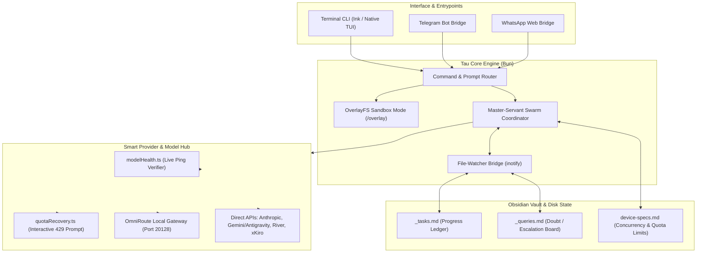

# Custom Tau Harness: Architecture, Pruning & Evolution Specification

**Repository:** `~/Projects/tau` (`right9code/tau`)  
**Runtime:** Linux (Omarchy / Hyprland), Bun / TypeScript  
**Primary Use Cases:**
1. High-speed, distraction-free terminal coding & system administration.
2. Study vault / Obsidian batch generation (`r9cn` vault: poetic devices, chapter revision HTML, multi-exam synthesis).
3. Free-tier multi-provider arbitrage with resilient 429 recovery and ping verification.
4. Remote interaction via mobile messaging (WhatsApp + Telegram).

---

## 1. System Architecture Overview



---

## 2. Pruning Plan (Deadweight Removal)

To eliminate unnecessary prompt tokens, reduce bundle footprint, and speed up CLI initialization on Bun:

### 2.1 Remove Windows Platform Shims
- `src/tools/PowerShellTool/`
- `src/utils/powershell/`
- *Impact:* Saves ~1.2k system prompt tokens on every message by removing Windows tool declarations on Linux.

### 2.2 Remove Marketing & Extraneous Nags
- `src/components/DesktopUpsell/` (Desktop GUI promotional dialogs)
- `src/commands/stickers/` (Sticker Mule browser opener)
- `src/components/FeedbackSurvey/`
- `src/components/TauMascot/` (Pixel-art sprite animation engine; keep static header banner in `LogoV2.tsx`)

### 2.3 Remove Enterprise Messaging & CI Installers
- `src/commands/install-slack-app/`
- `src/commands/install-github-app/`

### 2.4 Purge Legacy Provider Lanes
Retain only:
1. `firstParty` (Anthropic Direct)
2. `omniroute` (Local OmniRoute Gateway at `http://127.0.0.1:20128/v1`)
3. `openai` (Standard OpenAI)
4. `opencode`
5. `antigravity` (Gemini Flash tiered)
6. `ollama` (Local models)
7. `lmstudio` (Local models)
8. Custom OpenAI-compatible providers configured via `settings.json` (`river`, `xkiro`).

Delete unused vendor adapters from `src/lanes/` (bedrock, vertex, foundry, agentrouter, modelrouter, vercel, requesty, opencodego, commandcode, lxd, mimo, fireworks, cloudflare, groq, mistral, nim, deepseek, glm, moonshot, minimax, alibaba, xai, meta, cline, clinepass, copilot, cursor, iflow, kilocode, kiro).

---

## 3. Study Vault & Batch Generation Engine

Tailored for large, non-overlapping batch runs (e.g. generating poetic device notes for 8 poems, or 5 parallel exam papers):

### 3.1 Non-Overlapping Task Assignments (`_tasks.md`)
- Master breaks an objective down into distinct, isolated file targets.
- Workers never write to the same output note.
- Workers update their status in `_tasks.md` upon claiming and finishing:

| Task ID | Item | Assigned Worker | Status | Target File |
| :--- | :--- | :--- | :--- | :--- |
| T-01 | Poem: The Road Not Taken | Servant-1 | `completed` | `vault/literature/road-not-taken.md` |
| T-02 | Poem: Wind | Servant-2 | `in_progress` | `vault/literature/wind.md` |

### 3.2 Asynchronous Doubt & Escalation Board (`_queries.md`)
- When a worker encounters ambiguity, it pauses and writes a doubt into `_queries.md`.
- Bun's kernel file-watcher (`fs.watch` / `inotify`) detects the update with **0 wasted polling tokens** and wakes the Master.
- Master evaluates:
  - If resolvable via curriculum context: Master appends the answer directly.
  - If subjective/missing user decision: Master halts and alerts the user.

### 3.3 User Notifications
- When user input is required:
  - **In-terminal prompt:** Interactive selection in Tau CLI.
  - **Desktop notification:** Linux `notify-send "Tau: Master needs input" "Worker raised a query in _queries.md"`.

---

## 4. Free-Tier Quota & Rate-Limit Shield

Designed specifically for free-tier model operations:

### 4.1 Live Health Check on 429
When an agent encounters a `429`, `resource_exhausted`, or rate-limit error:
1. `isQuotaOrRateLimitError()` intercepts the error.
2. `modelHealth.ts` pings all configured models in parallel.
3. Unhealthy / exhausted models are filtered out.
4. An interactive prompt displays only **verified green, responsive models** with their measured latency:
   ```text
   ⚠️ Servant-2 hit rate limit (429: resource_exhausted)
   
   Verified Active Replacements:
   [1] river:GLM-5.3 (420ms) - OK
   [2] antigravity:gemini-3.8-flash-tiered (180ms) - OK
   [3] xkiro:free-tier (310ms) - OK
   [4] Pause and wait 60s cooldown
   [5] Abort task
   ```
5. The agent resumes seamlessly using the selected replacement model.

### 4.2 Hardware & Concurrency Limits (`device-specs.md`)
- **Global default:** `~/.config/tau/device-specs.md`
- **Vault override:** Optional local `device-specs.md` in the project root.
- Controls:
  - `max_parallel_workers`: 1–2 on strict free tiers to avoid rapid TPM/RPM burnout.
  - `stagger_delay_ms`: 3000ms pause between launching workers.

---

## 5. Remote Messaging Bridges

1. **WhatsApp Web Bridge:** Kept intact in `src/services/whatsapp/` for QR pairing and remote task execution.
2. **Telegram Bot Bridge:** New lightweight service in `src/services/telegram/`:
   - Uses Telegram Bot API via polling or webhook.
   - Provides `/status`, `/swarm`, and relay of Master queries directly to your phone.

---

## 6. Execution Roadmap

| Step | Action | Status |
| :--- | :--- | :--- |
| **Step 1** | Prune `PowerShellTool`, `DesktopUpsell`, `stickers`, `install-slack-app`, `install-github-app`, `TauMascot`. | Pending |
| **Step 2** | Clean legacy provider shims from `src/lanes/` and verify `bun run build`. | Pending |
| **Step 3** | Implement `device-specs.md` reader (global + vault override). | Pending |
| **Step 4** | Complete `_tasks.md` and `_queries.md` file-watcher bridge with `notify-send` desktop alert. | Pending |
| **Step 5** | Wire interactive live-ping 429 quota picker into execution loop. | Pending |
| **Step 6** | Build lightweight Telegram Bot service. | Pending |
